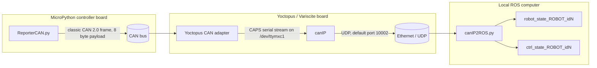
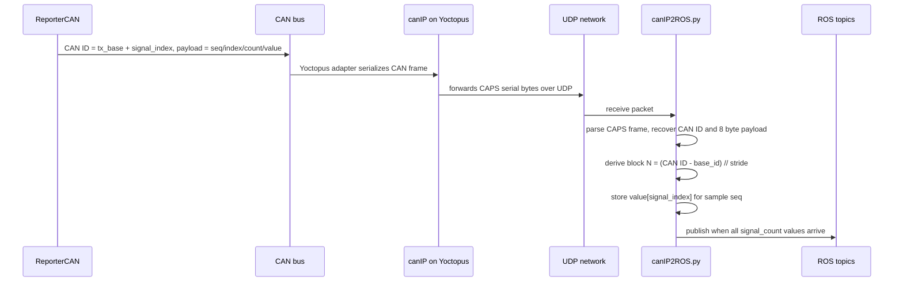
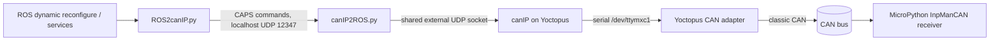

> **ROS2 note.** This is Lorenzo Vianello's README from `devel/CMbenchTop` (ef24346),
> written for ROS1. The protocol, CAN IDs and controller behaviour are the same in this
> ROS2 port; only the commands differ:
>
> | ROS1 | ROS2 |
> |---|---|
> | `roslaunch micropython_logger cubemars_can.launch ctrl:=X` | `ros2 launch micropython_logger cubemars_can.launch.py ctrl:=X` |
> | `rosservice call /can_motor_group/start` | `ros2 service call /can_motor_group/start std_srvs/srv/Trigger` |
> | `rosservice call /cmN/.../set_activity "{activity: 1, starting_state: -1}"` | `ros2 service call /cmN/.../set_activity micropython_logger/srv/SetCANActivity "{activity: 1, starting_state: -1}"` |
> | `rosparam set /cmN/.../save_name x` | `ros2 param set /cmN/... save_name x` |
> | `rosrun rqt_reconfigure rqt_reconfigure` | `ros2 run rqt_reconfigure rqt_reconfigure` (enums show as integer sliders) |
> | snapshots in `~/.ros/cubemars_sm_params/node_N/` | unchanged (`$ROS_HOME`) |

# micropython_logger CAN Bridge

This package receives telemetry from MicroPython controller boards and publishes it as ROS `Float64MultiArray` topics. The current CAN path is:

```text
MicroPython board
  ReporterCAN
  classic CAN frames
        |
        v
Yoctopus / Variscite Linux board
  CAN adapter serial device: /dev/ttymxc1
  canIP bridge
  UDP packets
        |
        v
Local ROS computer
  micropython_logger/src/canIP2ROS.py
  ROS topics
```

## Architecture



The package uses two separate receive bridges because the transports and packet formats are fundamentally different:

- `canIP2ROS.py` receives CAPS-framed CAN bytes forwarded by `canIP`, reconstructs samples per CAN ID block, and publishes suffixed per-board topics.
- `udp2ROS.py` receives the legacy direct Wi-Fi packet containing one contiguous float32 report and publishes unsuffixed topics.

## Implemented Changes

The CAN communication path now supports simultaneous telemetry reception and command transmission without modifying the Yoctopus `canIP` executable.

### Receive Bridge Separation

- `udp2ROS.py` is dedicated to the legacy direct Wi-Fi float-array protocol.
- `canIP2ROS.py` is dedicated to CAPS-framed CAN traffic received through Yoctopus `canIP`.
- The previous `source_mode` switch was removed so each executable has one transport and one packet format.
- `canIP2ROS.py` accepts CAN node lists as a scalar, comma-separated string, or YAML-style list, such as `1`, `1,2`, or `"[1,2]"`.

### Shared canIP Socket

Yoctopus `canIP` remembers one UDP client address and uses it for both incoming commands and outgoing telemetry. Two ROS processes communicating directly with `canIP` would therefore compete for that client association.

The implemented solution keeps the ROS processes separate while assigning external socket ownership to `canIP2ROS.py`:

```text
ROS2canIP.py
    |
    | localhost UDP 127.0.0.1:12347
    v
canIP2ROS.py
    |
    | one shared UDP source port
    v
canIP 192.168.20.2:10002
```

`canIP2ROS.py` now:

- Owns the only direct UDP connection to `canIP`.
- Continues receiving and decoding ReporterCAN telemetry.
- Listens for local command datagrams on `127.0.0.1:12347`.
- Validates that each local datagram contains complete CAPS classic-CAN frames with valid checksums.
- Forwards valid commands through the same socket used for telemetry.
- Rejects malformed command datagrams.
- Returns `CANIP_RELAY_OK` or `CANIP_RELAY_ERROR` to the local sender.
- Reports forwarded command datagrams, bytes, and rejected datagrams in its periodic statistics.

`ROS2canIP.py` now:

- Uses the local relay by default with `use_local_relay=true`.
- Waits for the relay acknowledgement before reporting a command sample as sent.
- Reports an error when `canIP2ROS.py` is unavailable or rejects the command.
- Retains direct diagnostic mode through `use_local_relay=false`.

The relay acknowledgement confirms that `canIP2ROS.py` validated and forwarded the datagram. It does not confirm that the MicroPython board received or applied the command.

### Verification

The implementation was checked with:

- CAPS validation and malformed-datagram rejection tests.
- Local relay acknowledgement tests.
- A catkin rebuild of `micropython_logger`.
- A two-process ROS integration test confirming that telemetry keepalives and command frames reached a canIP emulator from the same UDP source port.

## ReporterCAN Message Format

`ReporterCAN` sends one signal per CAN frame. A full report sample is reconstructed by collecting all signal indices for the same sample sequence number.

Classic CAN payload, always 8 bytes:

| Byte(s) | Name | Type | Meaning |
| --- | --- | --- | --- |
| `0` | `sample_seq` | `uint8` | Sample sequence counter, wraps at 255. |
| `1` | `signal_index` | `uint8` | Index of this value inside the full report vector. |
| `2` | `signal_count` | `uint8` | Number of signals expected in one full sample. Currently `27` (`0x1b`) for the CubeMars bench-top setup. |
| `3` | reserved | `uint8` | Reserved, currently `0`. |
| `4..7` | `signal_value` | little-endian `float32` | Value for `signal_index`. |

Payload layout example:

```text
byte:   0        1             2             3          4..7
      +--------+-------------+-------------+----------+------------------+
      | seq    | signal idx  | signal cnt  | reserved | float32 value LE |
      +--------+-------------+-------------+----------+------------------+
```

Example CAN frame from a board using CAN ID block `0x560..0x57A`:

```text
560   8   3c 00 1b 00 30 ab 06 45
```

This decodes as:

| Field | Value |
| --- | --- |
| CAN ID | `0x560` |
| DLC | `8` |
| `sample_seq` | `0x3c` |
| `signal_index` | `0` |
| `signal_count` | `0x1b` = 27 |
| reserved | `0` |
| value bytes | `30 ab 06 45` |

## CAN ID Mapping

ReporterCAN gives each board a block of CAN IDs. Each signal index maps to one CAN ID.

Formula:

```text
tx_base_id = can_base_id + can_node_id * can_id_stride
can_id     = tx_base_id + signal_index
```

Default configuration:

| Parameter | Default | Meaning |
| --- | ---: | --- |
| `can_base_id` | `0x500` | Start of ReporterCAN ID space. |
| `can_id_stride` | `32` | Number of CAN IDs reserved per board. Must be at least `signal_count`. |
| `signal_count` | `27` | Number of frames in one complete report sample. |

With `can_base_id = 0x500`, `can_id_stride = 32`, and `signal_count = 27`:

| Board slot / `can_node_id` | First CAN ID | Last CAN ID | Notes |
| ---: | ---: | ---: | --- |
| `2` | `0x540` | `0x55A` | Observed stable in testing. |
| `3` | `0x560` | `0x57A` | Observed to trigger Yoctopus stream issue in testing. |
| `4` | `0x580` | `0x59A` | Suggested workaround/test range. |

Important distinction: `can_node_id` is not a CAN protocol field. It is only our local configuration value used to choose a non-overlapping CAN ID block.

## Yoctopus / canIP Layer

On the Yoctopus / Variscite Linux board, `canIP` reads from the Yoctopus serial CAN device and forwards bytes to the local ROS computer over UDP.

Typical service path:

```text
/dev/ttymxc1 -> canIP -> UDP port 10002 -> local canIP2ROS.py
```

Typical commands used during testing:

```bash
systemctl stop can-ip
systemctl start can-ip
journalctl -u can-ip -f
```

Direct logger test, bypassing ROS and `canIP2ROS.py`:

```bash
/opt/cbm/bin/can-logger -d /dev/ttymxc1 -b 1000000 -p
```

This direct `can-logger` path is useful because if it stops printing frames, the issue is below ROS. In our tests, the stream could stop even with direct `can-logger`, which points toward the Yoctopus serial/CAN path or the CAN ID/framing interaction rather than ROS topic publication.

## Local CAN Layer: canIP2ROS.py

`canIP2ROS.py` owns the single UDP session with `canIP`, keeps it associated with a small keepalive, parses incoming CAPS CAN frames, reconstructs ReporterCAN samples, and publishes per-board ROS topics. It also exposes a localhost command relay so `ROS2canIP.py` can transmit through the same external UDP socket.

Default CAN/IP behavior:

| Setting | Default |
| --- | --- |
| local listen host | `0.0.0.0` |
| local listen port | `12346` |
| command relay host | `127.0.0.1` |
| command relay port | `12347` |
| `canip_host` | `192.168.20.2` |
| `canip_port` | `10002` |
| `can_base_id` | `0x500` |
| `can_id_stride` | `32` |
| `can_nodes` | `[2, 3]` |

Run for boards using ID blocks 2 and 4:

```bash
rosrun micropython_logger canIP2ROS.py _robot:=CubeMars _can_nodes:=2,4
```

Run only board block 4:

```bash
rosrun micropython_logger canIP2ROS.py _robot:=CubeMars _can_nodes:=4
```

The node-list parameter accepts a scalar, comma-separated values, or a YAML-style list:

```bash
_can_nodes:=4
_can_nodes:=2,4
_can_nodes:="[2,4]"
```

Expected startup print for blocks 2 and 4:

```text
ROS topic mapping node_id=2: robot_state_CubeMars_id2, ctrl_state_CubeMars_id2
ROS topic mapping node_id=4: robot_state_CubeMars_id4, ctrl_state_CubeMars_id4
CAN mapping: base_id=0x500, stride=32, nodes=[2, 4]
```

Published topics:

| Topic | Content |
| --- | --- |
| `robot_state_<robot>_id<N>` | Reporter timestamp/header plus robot values for CAN ID block `N`. |
| `ctrl_state_<robot>_id<N>` | Reporter timestamp/header plus controller values for CAN ID block `N`. |

For example:

```text
/robot_state_CubeMars_id2
/ctrl_state_CubeMars_id2
/robot_state_CubeMars_id4
/ctrl_state_CubeMars_id4
```

## Legacy Wi-Fi Layer: udp2ROS.py

`udp2ROS.py` is now dedicated to the original direct board-to-computer Wi-Fi transport. It expects exactly 27 contiguous little-endian `float32` values, or 108 bytes, in this order:

```text
reporter header (1)
controller-factory value (1)
controller values (10)
decorator values (5)
robot values (10)
```

Run it with the robot-specific default port:

```bash
rosrun micropython_logger udp2ROS.py \
  _robot:=CubeMars \
  _listen_host:=192.168.0.252
```

Default Wi-Fi ports:

| Robot | UDP port |
| --- | ---: |
| `Shadow` | `12344` |
| `Tails` | `12345` |
| `CubeMars` | `12346` |

The legacy bridge publishes unsuffixed topics:

```text
/robot_state_CubeMars
/ctrl_state_CubeMars
```

Use `_listen_port` to override the robot-specific port. This bridge does not parse CAPS frames, derive CAN ID blocks, or communicate with `canIP`.

## Reassembly Logic



A sample is considered complete when all indices from `0` to `signal_count - 1` arrive for the same `sample_seq`. If a new sequence starts before all values arrive, `canIP2ROS.py` publishes a partial sample with the values it has and increments the partial-sample counter.

## Current Issue Under Investigation

We observed an issue that appears tied to a specific transmitted CAN ID range:

| Test case | CAN IDs | Observation |
| --- | --- | --- |
| Board configured for block `2` | `0x540..0x55A` | Stream appears stable. |
| Board configured for block `3` | `0x560..0x57A` | Stream can stop after a while; direct `can-logger` can also stop. |
| Same physical board moved from block `3` to block `2` | `0x540..0x55A` | Stream appears stable; unexpected `0x268` frames disappear. |

Suspicious detail:

```text
The block 3 range includes CAN ID 0x565.
The low byte of 0x565 is 0x65.
The CAPS/Yoctopus serial start-of-message marker is also 0x65, ASCII 'e'.
```

The suspected failure mode is not that ReporterCAN sends an invalid CAN frame. `0x565` is a valid standard CAN ID. The concern is that the serial framing/parser may be fragile if byte `0x65` appears inside a CAN ID or payload and the parser ever loses byte alignment.

Observed symptom while using `0x560..0x57A`:

```text
Unexpected frame such as 0x268 appears in can-logger output.
```

That frame is not generated by ReporterCAN. It may indicate parser resynchronization on an internal `0x65` byte, byte loss, or another device on the CAN bus. The fact that it disappeared when the same board was moved to `0x540..0x55A` makes the ID-range hypothesis stronger.

### Question For Yoctopus / CAPS Maintainers

Could the Yoctopus/CAPS serial parser lose synchronization or wedge when byte `0x65` appears inside a CAN ID or payload instead of only at the start of a framed serial message?

## Suggested Workarounds And Tests

Short-term workaround: avoid CAN ID blocks that include low byte `0x65`.

With the current mapping, avoid block `3`:

```text
block 3: 0x560..0x57A includes 0x565
```

Use block `4` instead:

```text
block 4: 0x580..0x59A
```

Recommended tests:

1. Check whether `caps-ecosystem.target` is enabled at boot or currently active. It may start legacy CAPS services that compete for `/dev/ttymxc1` or otherwise affect the CAN/serial path.
2. Configure the same physical board that failed on block `3` to use block `4` and run `can-logger` directly.
3. Verify that `0x268` no longer appears.
4. Run `canIP2ROS.py` with `_can_nodes:=2,4` and verify topics publish continuously.
5. If possible, capture raw serial bytes from `/dev/ttymxc1` immediately after the stream stops to distinguish no-bytes from parser desynchronization.

Check the CAPS target state with:

```bash
systemctl is-enabled caps-ecosystem.target
systemctl is-active caps-ecosystem.target
systemctl status caps-ecosystem.target
systemctl list-dependencies caps-ecosystem.target
```

For an isolated test, stop it and prevent it from starting automatically:

```bash
systemctl disable --now caps-ecosystem.target
```

Re-enable it after testing if the system normally depends on the CAPS ecosystem:

```bash
systemctl enable --now caps-ecosystem.target
```

Raw serial byte check after failure:

```bash
systemctl stop can-ip 2>/dev/null
pkill -9 -x canIP 2>/dev/null
pkill -9 -x can-logger 2>/dev/null
stty -F /dev/ttymxc1 1000000 raw -echo -ixon -ixoff -crtscts
python3 - <<'PY'
import os, select, time
fd = os.open('/dev/ttymxc1', os.O_RDONLY | os.O_NONBLOCK | os.O_NOCTTY)
end = time.time() + 10
n = 0
sample = bytearray()
while time.time() < end:
    r, _, _ = select.select([fd], [], [], 0.1)
    if r:
        b = os.read(fd, 4096)
        n += len(b)
        if len(sample) < 80:
            sample.extend(b[:80-len(sample)])
os.close(fd)
print('raw_bytes_in_10s =', n)
print('sample_hex =', sample.hex())
PY
```


## Reverse Command Path: ROS2canIP

`src/ROS2canIP.py` implements the first half of the return path from ROS to the MicroPython boards:



The destination board's `InpManCAN` receiver reconstructs the indexed command sample and applies it through `CtrlFactory.processInputs`.

### Command Vector

The command vector preserves the existing `ROS2tcp.py` layout:

| Vector index | Count | Content |
| ---: | ---: | --- |
| `0` | 1 | Controller header. |
| `1..20` | 20 | Controller parameters. |
| `21..24` | 4 | Robot commands, including calibration requests. |

Each float is sent in one classic 8-byte CAN frame using the same indexed layout as ReporterCAN:

| Byte(s) | Meaning |
| --- | --- |
| `0` | Command sequence number. |
| `1` | Command-vector signal index. |
| `2` | Command-vector signal count, default `25`. |
| `3` | Reserved, currently `0`. |
| `4..7` | Little-endian float32 command value. |

Command CAN IDs are kept separate from telemetry IDs:

```text
tx_base_id = can_cmd_base_id + can_target_node * can_id_stride
can_id     = tx_base_id + signal_index
```

Current defaults:

```text
can_cmd_base_id = 0x300
can_target_node = 4
can_id_stride   = 32
command_count   = 25
inter_frame_delay_s = 0.002
command_ack_timeout_s = 5.0
send_idle_on_shutdown = true
command IDs     = 0x380..0x398
ACK ID          = 0x39F
```

The node warns at startup if its selected CAN ID range contains a low byte of `0x65`, due to the CAPS framing issue currently under investigation.

Command frames are paced by `2 ms` by default. This avoids sending the full
25-frame sample as one serial burst, which can silently lose trailing frames
when the current nonblocking `canIP` serial write accepts only part of the
datagram. Set `_inter_frame_delay_s:=0.0` only for explicit burst-mode testing.

Application-level command ACKs are enabled by default. The board sends an ACK
after `InpManCAN` has received the full command sample and `CtrlFactory` has
accepted or rejected it. The default ACK timeout is `5 s`, because this ACK must
travel through the full path `ROS2canIP -> canIP2ROS relay -> canIP -> CAN ->
Portenta -> CAN -> canIP -> canIP2ROS relay -> ROS2canIP`, and we observed that
`0.5 s` could be too short even when the command was applied correctly.

On normal shutdown, `ROS2canIP.py` sends one final all-zero command sample by
default. This is the CAN equivalent of the old TCP disconnect behavior: command
header `0` selects `ctrlInterface`, and the remaining zero values leave the
robot-command/calibration fields inactive. Disable it with
`_send_idle_on_shutdown:=false` for diagnostics where the current controller
should be left untouched.

### Run ROS2canIP

Start `canIP` on the Yoctopus, then start `canIP2ROS.py`. By default, `ROS2canIP.py` sends commands to the localhost relay rather than opening a second session with `canIP`.

Terminal 1:

```bash
rosrun micropython_logger canIP2ROS.py \
  _robot:=CubeMars \
  _can_nodes:=1
```

Terminal 2:

```bash
rosrun micropython_logger ROS2canIP.py \
  _robot:=CubeMars \
  _ctrl:=SMWalking \
  _can_target_node:=1 \
  _can_cmd_base_id:=0x300
```

Expected startup mapping:

```text
Command transport: local relay udp://127.0.0.1:12347 (canIP owner: canIP2ROS.py)
Command CAN IDs: base=0x300, target_node=1, stride=32, tx_base=0x320, range=0x320..0x338
Command ACK: enabled=True, ack_id=0x33F, timeout=5.000s
Shutdown idle command: enabled=True
```

Relay parameters must match between the two nodes:

| `canIP2ROS.py` | `ROS2canIP.py` | Default |
| --- | --- | --- |
| `command_relay_host` | `relay_host` | `127.0.0.1` |
| `command_relay_port` | `relay_port` | `12347` |

For direct one-way diagnostics without `canIP2ROS.py`, disable the relay explicitly:

```bash
rosrun micropython_logger ROS2canIP.py \
  _robot:=CubeMars \
  _ctrl:=SMWalking \
  _can_target_node:=1 \
  _use_local_relay:=false \
  _canip_host:=192.168.20.2 \
  _canip_port:=10002
```

Supported controller configurations match `ROS2tcp.py`:

```text
Teleop, SMWalking, OscillatorForce, OscillatorPos, FF, FB
```

Calibration services send one command sample with the corresponding robot-command flag asserted:

```bash
rosservice call /IMU_calibration
rosservice call /LoadCell_calibration
```

A successful service response means that `canIP2ROS.py` validated and forwarded the CAPS bytes through its shared socket. It is not yet an acknowledgement from the MicroPython board.

### Launch One Or Both CubeMars Motors

Use one launch file to start the receiver, the selected command nodes, and a
group dynamic-reconfigure control and start/stop services. Launching loads
SMWalking parameters with `enable_controller=false`; movement requires a
separate start request.

```bash
# Both motors, with CAN node IDs 1 and 2.
roslaunch micropython_logger cubemars_can.launch

# Only CM1. No readiness or ACK is required from CM2.
roslaunch micropython_logger cubemars_can.launch motor2:=false

# Only CM2.
roslaunch micropython_logger cubemars_can.launch motor1:=false
```

If `canIP2ROS.py` is already running, add `start_receiver:=false` and keep its
relay address/port consistent with the launch settings. The other launch
arguments include `node1_id`, `node2_id`, `canip_host`, `canip_port`,
`relay_port`, `command_ack_timeout_s`, and `starting_state`.

Open the group enable/disable control in rqt:

```bash
rosrun rqt_reconfigure rqt_reconfigure
```

Select **`/can_motor_group`** and toggle **`enable_controller`**. Checking it
starts the selected controllers after the readiness checks below; unchecking it
sends a disable request to each selected motor. It controls only the motors
selected by the launch (`motor1`/`motor2`). The group always starts unchecked,
even if a previous enable value was stored, and opening the GUI sends no commands.
The terminal reports the ACK results. A failed start resets the checkbox and
attempts to disable all selected controllers.

The services remain available and update the same group checkbox:

```bash
rosservice call /can_motor_group/start "{}"
rosservice call /can_motor_group/stop "{}"

# Reapply the current parameters while disabled, e.g. after an initial ACK timeout.
rosservice call /can_motor_group/prepare "{}"
```

The group start first checks that every selected command node has a valid board
ACK for its latest command. It refuses to send any enable requests if a node is
not ready. The enable requests are then dispatched concurrently, so the second
motor does not wait for the first motor's ACK. If any start cannot be confirmed,
the group attempts to disable all selected controllers and reports both the
start and disable results. This is not an atomic transaction: a motor can begin
moving before another motor reports a failure.

This provides **approximate simultaneous starting**, not a common execution
instant. Each Portenta still starts after its complete command is processed.
The existing canIP high-level start-state selection remains active. A shared CAN
release message, clock synchronization, and continuing phase correction are
separate future options. Stop disables the walking controller through its normal
enable flag; it is not a hardware emergency stop. An unchecked group checkbox
is not proof of a physical stop: check the terminal for successful disable ACKs.
If disabling cannot be confirmed, use the `stop` service to retry the requests.

The command nodes have separate namespaces, avoiding calibration-service name
collisions. Select these nodes in `rqt_reconfigure` to edit their parameters
before using the group checkbox. Their individual enable flags remain available
but bypass the group readiness checks; they do not update the group checkbox:

| Motor | Dynamic-Reconfigure Node | Individual Services |
| --- | --- | --- |
| CM1 | `/cm1/ROS2canIP_can_node_1` | `.../ready`, `.../prepare`, `.../start`, `.../stop` |
| CM2 | `/cm2/ROS2canIP_can_node_2` | `.../ready`, `.../prepare`, `.../start`, `.../stop` |

The node-name suffix follows `node1_id`/`node2_id` if you override those IDs.
Calibration services are `/cm1/IMU_calibration`, `/cm1/LoadCell_calibration`,
and the corresponding `/cm2/...` names. Standalone `rosrun` names remain as
before. The command nodes wait for the local relay at launch, and never start
walking automatically, even if a previous GUI enable parameter was stored.

Today's tasks and the deferred coordination alternatives are recorded in
[TODO.md](TODO.md).

Group-control regression tests (source `devel/setup.bash` first; no ROS master
or physical motors needed):

```bash
python3 "$(rospack find micropython_logger)/tests/test_can_motor_group.py"
```

### CubeMars Multiple Locomotion Activities And Save/Load

The optional `SMMultipleAct` CAN controller keeps the CubeMars **two-state
Extension/Flexion** cycle and adds the Fox activity names in this wire order:
`OW=0`, `StairsAsc=1`, `StairsDesc=2`, `RampAsc=3`, `RampDesc=4`, `StS=5`.
StS uses the same repeating Extension/Flexion cycle, not a one-shot sit/stand
action. Its group initialization uses the same phase on both motors; the other
five activities start in opposite phases. The Fox TCP
controller, its four-phase GUI and its saved parameters are unchanged.

**The shipped activity profiles are identical bench placeholders, not tuned or
validated stairs/ramp/StS locomotion.** Tune and bench-test the parameters before
using them on hardware. Motor position limits still apply; a target outside the
board's configured limits is rejected, not silently clamped by this controller.
No limits are relaxed by this change.

After updating the Portenta firmware and canIP source as described below, stop
the old launch and run:

```bash
roslaunch micropython_logger cubemars_can_multi_activity.launch
rosrun rqt_reconfigure rqt_reconfigure
# Single-motor option: add motor2:=false (CM1) or motor1:=false (CM2).
```

In `/cm1/ROS2canIP_can_node_1` or `/cm2/ROS2canIP_can_node_2`:

1. While disabled, select an `activity` and a `phase` in the motor panel and tune
   its parameters. Both dropdowns choose a profile to edit/view only.
2. `q_eq`, `qdot_eq`, `dt`, `K`, `B` belong to that activity/phase pair;
   `vel_tresh` and `Fz_tresh` belong to the entire activity. The current two-state
   transition guards still use position/velocity, not force; `Fz_tresh` is stored
   but does not add a force-based transition.
3. Enter `save_name` and check `save_now` to save **all six activities and both
   phases for this motor**. The checkbox resets after the operation.
4. While disabled, enter `load_name` and check `load_now` to restore a snapshot.
   Loading never enables the controller. The currently **requested** activity
   is sent to the board with an ACK check, regardless of the profile being
   viewed. Other loaded profiles are sent when the group requests them.
5. Select `/can_motor_group/activity` to request one locomotion activity for
   every selected motor. Select `starting_phase` while stopped, then use its
   `enable_controller` checkbox to start/stop.
   The group uses each motor's own parameters, not one shared angle/gain profile.

Switching either per-motor dropdown only changes which profile/row the GUI
displays; it does not request a motion, change the running activity, or send a
CAN command. The status-only `requested_activity` field shows the most recent
commanded activity, which may still be pending at the board. Edits to other
activities are cached locally until the group requests them; edits to the
requested profile while disabled are sent as complete profiles.

The multi-activity launch adds an `activity` enum to `/can_motor_group`. Selecting
it sends the same activity index to all selected motors, with their separate
Extension/Flexion angles, gains, durations and thresholds. While enabled, each
board retains its trajectory/gains until the **next local phase boundary**.
This is shared behavior selection, not an atomic switch or continuous phase
synchronization. Parameter edits and snapshot loads while enabled are refused.
Saving is permitted while running.
An `APPLIED` ACK confirms receipt/acceptance of the request, not that a queued
activity has already become active or that motion has completed.

#### StS And Starting-Phase Policy

The group explicitly assigns start phases before enabling, independent of the
order in which packets arrive at canIP:

| Activity | `starting_phase` | First Selected Motor | Second Selected Motor |
| --- | --- | --- | --- |
| OW / stairs / ramps | Extension (`0`, default) | Extension | Flexion |
| OW / stairs / ramps | Flexion (`1`) | Flexion | Extension |
| StS | Extension (`0`, default) | Extension | Extension |
| StS | Flexion (`1`) | Flexion | Flexion |

"First" follows the selected controller order, not CAN ID parity. With only
CM1 or CM2 selected, that single motor uses `starting_phase`. Different motor
parameters remain independent in all activities.

Disable the group before entering/leaving StS or changing `starting_phase`.
Such changes while enabled are refused with a warning and restored GUI values;
they do not send new motion commands. A combined disable-and-selection request
stops first and configures the new activity only after confirmed disable ACKs.
The Portenta also rejects live changes into/out of StS. Other locomotion activity
changes can still be queued at the next local boundary without restarting.

For a motor joining later through an individual AUTO start (`starting_state=-1`),
updated canIP uses a fresh, enabled header-9 report with matching active/pending
activity and matching requested activity: opposite phase for locomotion, same
phase for StS. If no suitable source exists, AUTO retains the board default
(Extension). The sender transmits activity index 3 before starting-state index 2
so this decision uses the current command, never a previous command's activity.
Indices and checksums still describe the logical 25-value vector.

These rules align **initial phase only**. Group requests are concurrent but not
an atomic simultaneous CAN release; autonomous transitions and different
durations can cause phase drift. StS does not yet enforce simultaneous phase
transitions or stop after one sit/stand movement.

Group startup resets stored enable/activity selections to disabled/OW without
sending enables. Each group start re-sends and confirms the shared activity on
all selected motors before sending their enable requests. If an activity ACK is
missing/rejected, group enable resets, the activity selector returns to the last
all-ACK selection, and disable requests are attempted for all selected motors.
A missing disable ACK means physical stopping is **not confirmed**. Some boards
may have accepted the new activity before the failure; the next successful
prepare/start re-aligns the requested profiles. This is not transactional CAN.
The legacy `SMWalking` launch keeps its original enable-only group controls.

The group uses the private typed `~set_activity` service on each command node
(`micropython_logger/SetCANActivity`, request fields `activity` and
`starting_state`) so GUI browsing cannot become an activity
request accidentally. Use the group selector for normal coordinated operation,
not independent calls to these motor services.

Defaults come from `cubemars_sm_params/default.yaml`. Snapshots are stored at
`${ROS_HOME:-$HOME/.ros}/cubemars_sm_params/node_<id>/<name>.yaml`, keeping
motors separate. Override `~sm_saved_dir` if needed. Each snapshot carries its
CAN node ID; loading another motor's snapshot is refused. YAML validation is
all-or-nothing, filenames cannot traverse directories, and saving uses an
atomic file replacement. Fox four-phase snapshots are intentionally rejected.
New snapshots use schema version 2. Version-1 five-activity snapshots are still
accepted: the original five profiles are preserved, an independent untuned StS
bench profile is added, and a warning is shown. Loading does not overwrite the
old file; save a new snapshot after tuning StS. Version-2 files require all six
activities.

Private services `~SaveSMParams` and `~LoadSMParams` use the `~save_name` and
`~load_name` parameters. For example:

```bash
rosparam set /cm1/ROS2canIP_can_node_1/save_name bench_cm1
rosservice call /cm1/ROS2canIP_can_node_1/SaveSMParams "{}"
```

To load a snapshot at launch without enabling motion:

```bash
roslaunch micropython_logger cubemars_can_multi_activity.launch \
  node1_sm_params_file:=$HOME/.ros/cubemars_sm_params/node_1/bench_cm1.yaml
```

Command layout remains 25 floats and uses controller header **9**, separate
from `SMWalking=4` and `SMWalking3States=8`:

| Command Index | Meaning |
| --- | --- |
| 0 | Controller header (`9`) |
| 1 | Enable controller (`0` / `1`) |
| 2 | Starting state (`-1` default, `0` Extension, `1` Flexion) |
| 3 | Requested activity index (`0..5`, StS=`5`) |
| 4..8 | Extension: angle, velocity, duration, K, B |
| 9..13 | Flexion: angle, velocity, duration, K, B |
| 14..15 | Velocity and force thresholds |
| 16..20 | Reserved zeros |
| 21..24 | Existing robot calibration flags |

CAN IDs, ACK IDs, frame pacing, and telemetry dimensions are unchanged.
`ctrl_state_CubeMars_id<id>.data[0]` remains the board report time;
`data[1..4]` contains phase, active activity, pending activity, and enable status
for this controller. This distinguishes a
queued request from an actual activity transition. The updated canIP recognizes
header 9 for activity-aware start-state synchronization; it still aligns only the
initial phase, not continuing timing or activity choice across motors.

Deployment requires these **source** changes:

- Portenta: add `lib/Controllers/ctrlSMMultipleAct.py`, update
  `lib/CtrlFactory/CtrlFactory.py`, and register `ctrlSMMultipleAct` with header 9
  in each board's `config_params/params.json`. Preserve each board's existing
  CAN node ID, hardware settings, and position limits. Do not overwrite board 1
  with the repository's board-2 configuration. Reboot to load the new class.
- Verasite: copy the updated `can-ip/src/highlevel_controller.c` and `.h`, rebuild
  `canIP`, and replace/restart `cbm-can-ip.service` as before. Keep the existing
  UDP and `-T` timestamp arguments. No network settings are changed.
- Computer: rebuild/source `micropython_logger`. The original
  `cubemars_can.launch` still defaults to `SMWalking` for compatibility.

The StS addition requires the updated Portenta controller class and canIP
high-level sources even if the preceding five-activity version was installed.
The CAN vector size remains unchanged; rebuild ROS because the private service
and dynamic-reconfigure definitions have changed.
Restart the ROS launch and reconnect rqt after rebuilding the new service and
dynamic-reconfigure types. When Conda shadows system Qt, start rqt explicitly:

```bash
/usr/bin/python3 /opt/ros/noetic/lib/rqt_reconfigure/rqt_reconfigure
```

No physical motors or mounted boards are updated by these development changes.
Profile and ROS callback tests need no ROS master:

```bash
/usr/bin/python3 "$(rospack find micropython_logger)/tests/test_can_sm_profiles.py"
```

The optional end-to-end test starts an isolated ROS master and localhost
simulated boards, then exercises the actual relay, command nodes, rqt interface,
group services and save/load. It does not address physical CAN devices:

```bash
/usr/bin/python3 "$(rospack find micropython_logger)/tests/check_can_multi_activity_runtime.py"
```

### Shared UDP Ownership

The UDP implementation of `canIP` tracks one client address for both directions. Therefore, only `canIP2ROS.py` communicates directly with `192.168.20.2:10002`.

`ROS2canIP.py` remains a separate ROS process, but sends complete CAPS command datagrams to `127.0.0.1:12347`. `canIP2ROS.py` validates each datagram, forwards it through its existing canIP socket, and returns a local acknowledgement.

Do not run direct mode and relay mode simultaneously because direct traffic can still replace the client address remembered by `canIP`.

### Initial End-to-End Test

1. Start `canIP` on the Yoctopus.
2. Start `canIP2ROS.py` and verify `Command relay listening on udp://127.0.0.1:12347`.
3. Start `ROS2canIP.py` with the target node matching the board configuration.
4. Change a dynamic-reconfigure value and verify `Sent command sample`.
5. With `input_manager.can_debug_enabled=true`, verify the board reports a complete command sample.

## File References

| Component | File |
| --- | --- |
| MicroPython CAN reporter | `upy-app-exo/lib/IO/ReporterCAN.py` |
| Legacy ROS Wi-Fi bridge | `micropython_logger/src/udp2ROS.py` |
| ROS canIP/CAN bridge | `micropython_logger/src/canIP2ROS.py` |
| ROS CAN command transmitter | `micropython_logger/src/ROS2canIP.py` |
| Yoctopus CAN-IP bridge | `Yoctopus/cbm-linux-utils/can-ip/src/canIP.c` |
| Yoctopus direct logger | `Yoctopus/cbm-linux-utils/can-logger/src/logger.c` |
